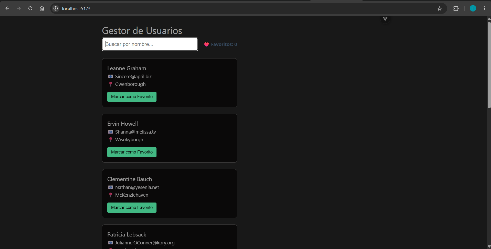
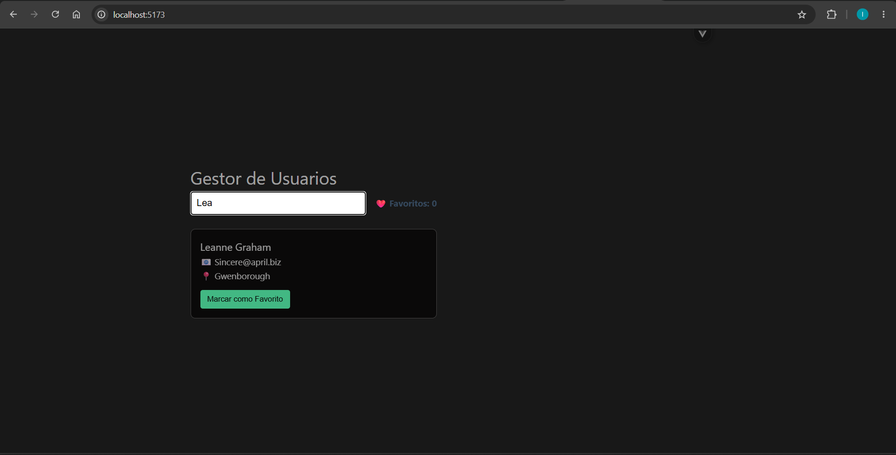
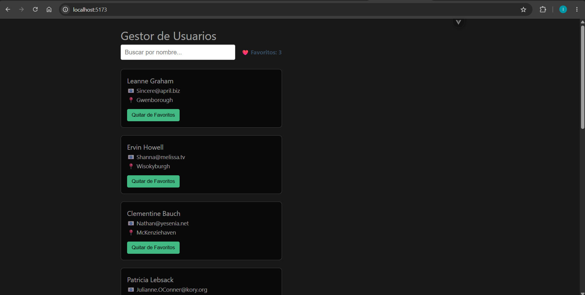
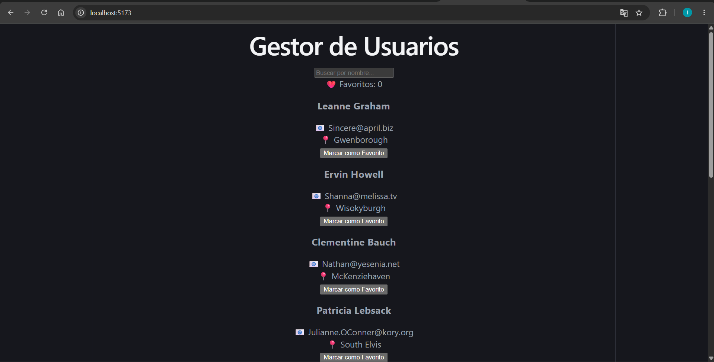
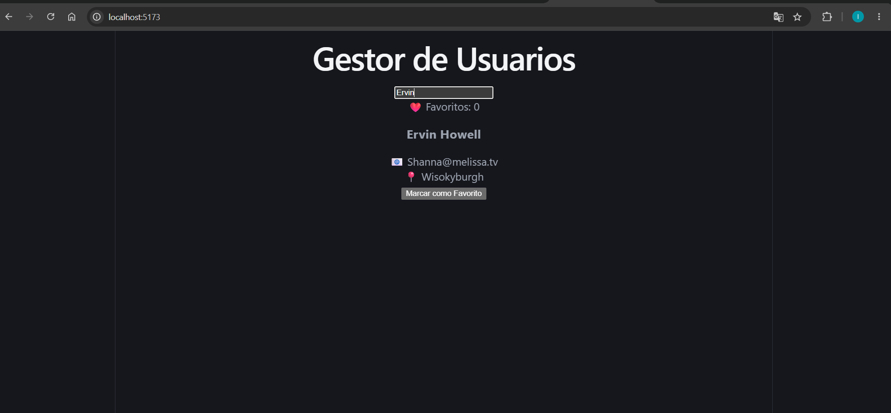
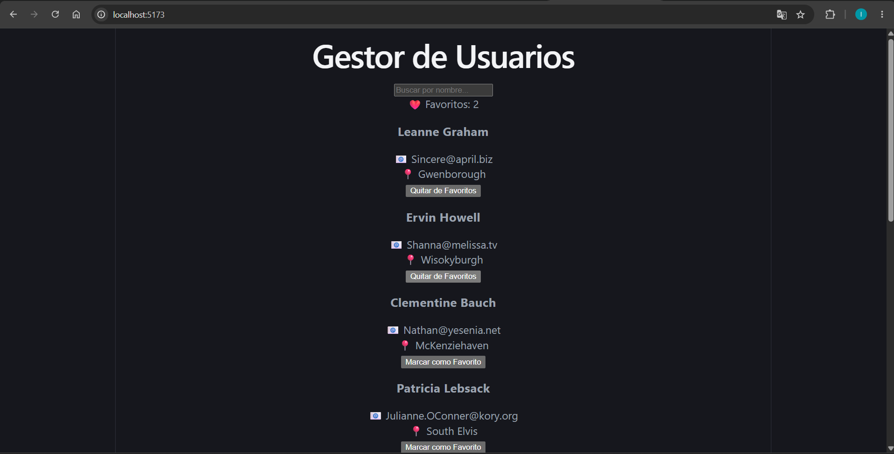

# Gestor de Usuarios Multi-Framework · Vue 3 + React 19

Proyecto de práctica que construye **la misma aplicación pequeña en dos frameworks distintos** para experimentar cómo se trabaja en cada uno. La implementación sigue la **Receta en seis pasos** y las secciones correspondientes de la *Referencia Rápida: Angular, React y Vue* (Angular 22.2 · React 19.3 · Vue 3.5).

##  API utilizada

`https://jsonplaceholder.typicode.com/users` (solo lectura).

##  App 1 · Vue 3

### Comandos de ejecución

| Acción | Comando |
|---|---|
| Instalar dependencias | `cd gestor-vue && npm install` |
| Levantar en desarrollo (puerto 5173) | `npm run dev` |
| Ejecutar pruebas unitarias | `npx vitest run` |
| Build de producción (genera `dist/`) | `npm run build` |

### Evidencias · Vue

| # | Qué muestra | Imagen |
|---|---|---|
| 1 | App cargada con las 10 tarjetas (nombre, correo, ciudad) |  |
| 2 | Buscador filtrando en tiempo real |  |
| 3 | Favoritos marcados y contador actualizado |  |

---

## 🔵 App 2 · React 19

### Comandos de ejecución

| Acción | Comando |
|---|---|
| Instalar dependencias | `cd gestor-react && npm install` |
| Levantar en desarrollo (puerto 5173) | `npm run dev` |
| Ejecutar pruebas unitarias | `npx vitest run` |
| Build de producción (genera `dist/`) | `npm run build` |

### Evidencias · React

| # | Qué muestra | Imagen |
|---|---|---|
| 1 | App cargada con las 10 tarjetas (nombre, correo, ciudad) |  |
| 2 | Buscador filtrando en tiempo real |  |
| 3 | Favoritos marcados y contador actualizado |  |

